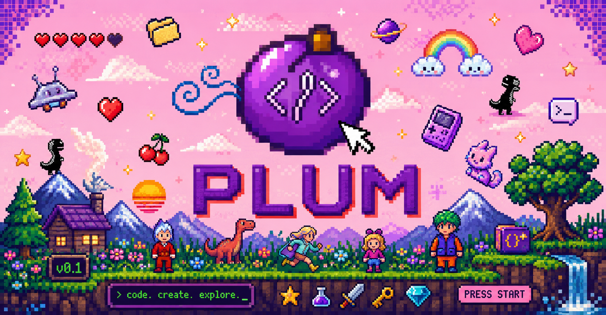

<div align="left">

# 🍑 Plum Programming Language


### A lightweight programming language built from scratch with Python.
<p>
  
  <strong>Learn. Build. Experiment. Create.</strong>
</p>

<p>
  An open-source project exploring how programming languages work internally —
  from source code to execution.
</p>

</div>

---

## 🍑 About Plum

**Plum** is an open-source interpreted programming language built entirely from scratch using **Python**.

The goal of Plum is to explore the fundamentals of programming language design and implementation without relying on parser generators or compiler frameworks.

Instead, every major component is built step by step — including the lexer, parser, AST, interpreter, and eventually the runtime.

Plum is both a learning project and an experiment in designing a small, expressive programming language.

---

## 🚀 Project Status

Plum is currently under active development.

### Current Version — `v0.2`

> 🚧 **v0.2 is currently in development.**

- ✅ Lexer
- ✅ Basic expressions
- 🚧 Operators
- 🚧 AST (Abstract Syntax Tree)
- 🚧 Interpreter
- 🔜 Variables
- 🔜 Control flow
- 🔜 Functions

The language is expected to evolve significantly as new features are introduced.

---

## ✨ Example

Plum programs are designed to remain simple and readable.

```plum
drop 42
drop "Hello World"

drop 5 + 10
drop 10 + 20 + 5
